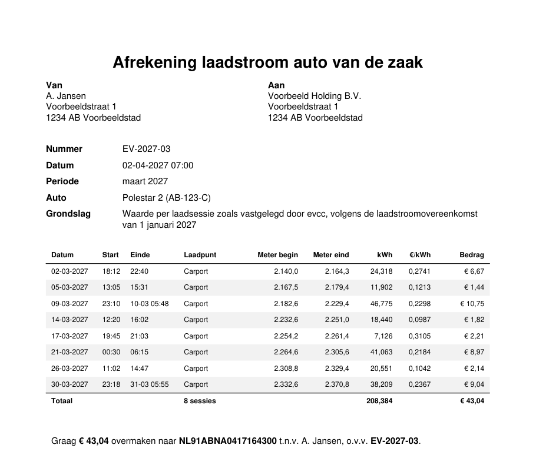

# evcc-chargeback

Send a monthly statement for the home charging cost of a company car, from the session data of
[evcc](https://evcc.io).

The tool is for this situation: you charge a company car at home, on your private energy contract, and evcc
controls the charger. The company pays you back each month. The tool makes the statement and the evidence for it.

The statement is in Dutch. Other languages are not available.



## What the tool does

1. It reads the finished charging sessions of the previous month from the evcc API.
2. It selects the sessions of the company car.
3. It calculates the amount of each session (see "Price basis").
4. It makes a PDF with the session list, the meter readings and the total amount.
5. It sends the PDF by email to the company.
6. It keeps the PDF and a record file with the source data of evcc.

The tool only reads from evcc. It sends GET requests to `/api/sessions` and `/api/state` and changes nothing.

## Rules

- A session belongs to the month in which it starts, in the time zone `BILLING_TZ`.
- The energy of a session is the value that evcc recorded from the meter of the charge point, rounded to Wh.
- The total is the sum of the rounded session amounts.
- The tool sends a statement one time only. To send a correction, use `--force`.
- The tool sends a statement only for a month that has ended.
- The tool does not send a statement when the month is not complete. See "When the tool stops".

## Price basis

Set `PRICE_BASIS` to one of these values. Ask your accountant which basis is correct for you.

| Value | Amount of a session | Title of the document |
|---|---|---|
| `agreed` | kWh x the tariff of the start day, from `AGREED_TARIFFS` | Afrekening laadstroom |
| `evcc` with `AGREEMENT_REF` | The value that evcc recorded for the session | Afrekening laadstroom |
| `evcc` without `AGREEMENT_REF` | The value that evcc recorded for the session | Declaratie laadkosten |

`agreed` is for a written agreement between you and the company with a fixed price per kWh. Put the reference to
the agreement in `AGREEMENT_REF`. The statement shows it. Add a new entry to `AGREED_TARIFFS` when the price
changes: `2027-01-01:0.31,2028-01-01:0.29`.

`evcc` with `AGREEMENT_REF` is for a written agreement that makes the value from evcc the price: grid energy at
the grid price of that moment, own energy at the feed-in price. The statement shows the reference.

`evcc` uses the cost that evcc calculates. evcc prices grid energy at the grid tariff of that moment. It prices
energy from your solar panels and your home battery at the feed-in tariff. This is not the full cost price per kWh
of your energy contract.

For the Netherlands, read the positions of the Belastingdienst before you choose: KG:204:2024:13, KG:204:2024:14
and KG:204:2026:16 (kennisgroepen.belastingdienst.nl). This tool does not give tax advice.

## Vehicle selection

evcc stores the vehicle title in each session. Set `EVCC_VEHICLE` to the title of the company car. If you renamed
the vehicle in evcc, give the two titles, with a comma between them.

Make sure that evcc knows which car charges:

- Give each car its own RFID tag and add the tag to the vehicle in evcc (`identifiers`).
- Do not make the company car the default vehicle of a charge point that other cars use.
- Set `EVCC_IDENTIFIERS` to the RFID tags of the company car. The tool then finds sessions that started with such
  a tag but have a different vehicle.

You can correct the vehicle of a finished session in the evcc user interface (Sessions page).

## When the tool stops

The tool does not send the statement, and tries again on the next day, when:

- evcc does not answer.
- A session of the month has no vehicle, or has a different vehicle than its RFID tag says.
- A car has been connected to a charge point since before the end of the month. evcc stores a session only when
  the car disconnects.
- A session has no cost in evcc (price basis `evcc` only).
- The mail server refuses the connection, the login, the sender or all recipients.
- The mail server refuses the message with an error answer after it received the message data.

Set `ALERT_TO` to get an email when a scheduled run fails. Set `ALLOW_INCOMPLETE=true` to ignore the vehicle and
connection checks.

`ALLOW_INCOMPLETE=true` has a risk. A car can be connected at the end of the month. The tool then sends the
statement without the session of that car. That session starts in the old month, which is already sent. Thus no
statement includes it.

In some cases a send stops halfway. Some recipients or all recipients can then have the statement:

- The mail server accepted the message for some recipients only.
- Another error occurred after the send started, for example a lost connection or no answer. The result is not
  known.

In these two cases the tool does not try again by itself. The file `EV-YYYY-MM.sending` stays. Each next run of
that month stops with an error. Look in the mailbox of the recipients. Then do one of these actions:

| Result in the mailbox | Command | Scheduled action |
|---|---|---|
| All recipients have the statement | `--period YYYY-MM --mark-sent` | `ACTION=mark_sent` |
| No recipient has the statement | `--period YYYY-MM --force` | `ACTION=resend` |
| Some recipients have the statement, others do not | See the steps below | See the steps below |

Email gives no proof that a message did not arrive. A mail server can keep a message in a queue for hours or days.
Thus you cannot be fully sure that a recipient does not have the statement. Before you send another copy with
`--force` or by hand, do these steps:

1. Ask each recipient to confirm that the statement did not arrive.
2. If you can, look in the queue or the log of the mail server.

After these steps, the first copy can still arrive at a later time. The recipient then has two copies. The two
copies have the same number `EV-YYYY-MM`. A correction from `--force` has the word "gecorrigeerd" in the subject.
Its PDF has a "Vervangt" line. Tell the recipients to use the newest copy.

`--mark-sent` records the month as sent and removes the `.sending` marker. It sends no email and does not change
the PDF or the record. The PDF of the month must be in `OUTPUT_DIR`. If the PDF is not there, `--mark-sent` stops
with an error. You can always restore the PDF, because it is the attachment of the statement that arrived:

- If a recipient has the statement, save its attachment as `EV-YYYY-MM.pdf` in `OUTPUT_DIR`. You can also restore
  the file from a backup. Then run `--mark-sent` again. Do not use `--force`, because the recipients then get a
  second version.
- If no recipient has the statement, use `--force` to make and send the statement again. Do the two steps above
  first.

The record (`EV-YYYY-MM.json`) is not necessary for `--mark-sent`. If the record is missing, `--mark-sent` marks
the month as sent and writes a warning to the log. The source data of that statement is then not kept. If you have
a backup of the record, restore it.

`--force` makes the statement again and sends it as a correction to all recipients. If a recipient already has
the statement, that recipient gets two versions. In the hour in which the clock goes back in `BILLING_TZ`,
`--force` stops with an error and does nothing. Run it again after that hour.

When some recipients have the statement and others do not, do these steps:

1. Ask each recipient without the statement to confirm that it did not arrive.
2. If you can, look in the queue or the log of the mail server.
3. Find the file `EV-YYYY-MM.pdf` in `OUTPUT_DIR`.
4. Send this file by email to the recipients who confirmed that they do not have it. Do this by hand.
5. Run the tool with `--period YYYY-MM --mark-sent`, or set `ACTION=mark_sent`.

A recipient can still get the first copy at a later time. The two copies are then the same statement with the
same number.

The tool also does not send when evcc has no sessions of the car for a month that the tool sent before. Each run
reports an error for that month. The tool cannot correct a sent statement to zero. Settle that statement by hand.

A configuration fault at the start of `--schedule` stops the tool. The tool then does not send an alert email.
Read the log.

## Files

The tool writes these files to `OUTPUT_DIR`. Keep them with your records. Use one output directory for each car.

The `.sent`, `.sending`, `.empty`, `.replaced-<time>.sent` and `.replaced-<time>.sending` files are markers. Do
not delete them. Without the `.sent` and `.sending` markers, the tool sends the statement again.

If you do not set `STATE_DIR`, all files are in `OUTPUT_DIR`. If you set `STATE_DIR`, the tool writes the markers
to `STATE_DIR`. The PDF and JSON files stay in `OUTPUT_DIR`.

If you set `STATE_DIR` at a later time, keep `OUTPUT_DIR` the same. The tool continues to read the old markers in
`OUTPUT_DIR`. It does not move them to `STATE_DIR`. Two operations change old markers in the two folders. A
correction renames the `.sent` and `.sending` markers to `.replaced-<time>` files. A new look at a month without
sessions removes the `.empty` marker.

| File | Contents |
|---|---|
| `EV-YYYY-MM.pdf` | The statement that was sent |
| `EV-YYYY-MM.json` | The record: session lines, total, SHA-256 of the PDF and the source sessions from evcc |
| `EV-YYYY-MM.sent` | The date of the send |
| `EV-YYYY-MM.sending` | A send that stopped halfway. See "When the tool stops". `--mark-sent` removes it. |
| `EV-YYYY-MM.empty` | The month had no sessions of the car. Use `--force` to look again. |
| `EV-YYYY-MM.replaced-<time>.*` | An earlier statement that `--force` replaced |
| `EV-YYYY-MM-draft.pdf` | The result of `--dry-run`. This file is not a statement. |

evcc permits changes to a finished session, also without a login. The record file shows the data at the time of
the statement.

## Commands

```sh
evcc-chargeback --period 2026-10 --dry-run   # make a draft PDF for October 2026, send nothing
evcc-chargeback                               # make and send the previous month
evcc-chargeback --period 2026-10 --force      # make and send October again, as a correction
evcc-chargeback --period 2026-10 --mark-sent  # record that the stopped send of October arrived, send nothing
evcc-chargeback --schedule                    # stay active and send each month (the container default)
```

## Schedule

With `--schedule` the tool stays active. It does a run when it starts, and then each day at `RUN_AT`. The previous
month is due from day `RUN_DAY`. After a successful send, the next runs do nothing for that month.

The tool sends each month from a start month until that month is sent. Thus a month that fails for a long time
is not lost. A failed month stays due also after the next month starts.

A month with an open correction is also due, also when it is before the start month. A correction is open when
the tool replaced an earlier version of the statement (a `.replaced-<time>.sent` or `.replaced-<time>.sending`
marker) and the month has no `.sent` and no `.sending` marker. Each run tries to send the open correction again.
An `.empty` marker does not close an open correction. If evcc has no sessions of the car for that month any more,
each run reports an error for that month. The run continues with the other due months. The tool does not correct
a sent statement to zero automatically. Settle that statement by hand. Other months before the start month are not
sent.

At the first start, the tool writes the start month to the file `first-period` in `STATE_DIR` (or
`OUTPUT_DIR`). This is the
month before the day of the first start. At each next start, the tool reads this file.

Set `FIRST_PERIOD` to use a different start month (`YYYY-MM`). `FIRST_PERIOD` has priority over the file. Use it
to send older months that are not sent yet.

Earlier versions of the tool did not write the file `first-period`. If you upgrade from such a version, set
`FIRST_PERIOD` to the earliest month that is not sent yet.

`ACTION` and `ACTION_PERIOD` start a recovery action at the start of `--schedule`. This is for an installation
without a shell, for example the Home Assistant app. Set `ACTION_PERIOD` to the month (`YYYY-MM`). Set `ACTION` to
one of these values:

- `none`: no action. This is the default.
- `resend`: the same as `--period YYYY-MM --force`.
- `mark_sent`: the same as `--period YYYY-MM --mark-sent`.

`ACTION_ID` is optional. It is a free id of the request, for example `2`. It has a maximum of 32 characters. Use
only letters, digits, `.`, `_` and `-`. The default is empty.

The tool does an action one time only, also when the action fails. Before the action starts, the tool writes the
action, the month and the id to the file `last-action` in `STATE_DIR` (or `OUTPUT_DIR`). At a next start with the
same action, month and id, the tool does nothing. `ACTION=none` clears the stored request and is the normal state.

To do the same action again, change `ACTION_ID` (for example from empty to `2`) and restart one time. A different
id makes a new request. The tool then does the action first in that start, before the schedule runs.

The tool does not do an action in the hour in which the clock goes back in `BILLING_TZ`. It does not store the
request and sends an alert. Restart the tool after that hour.

If the action fails, the tool sends an alert. The tool does not do the action again by itself. The schedule then
continues as usual:

- If the mail server refused the correction, the month has an open correction. Each run tries the correction
  again. This is also true for a month before the start month. If evcc has no sessions of the car for that month
  any more, each run reports an error for that month. The tool does not correct a sent statement to zero.
  Settle that statement by hand.
- If the result of the send is not known, the `.sending` marker stays. Look in the mailbox again.

The log shows if the action is done or failed. If the tool stopped during the action, the log can show no result.
The log of the next start then says that the action "was started at an earlier start and does not run again".

Before you ask for `resend`, always look in the mailboxes if the statement arrived. The markers and the log cannot
tell the result of a send with an unknown result.

After an interrupted `mark_sent`, ask for `mark_sent` again with a new `ACTION_ID`. On the command line, run
`--period YYYY-MM --mark-sent` again. `mark_sent` sends no statement. If the first try was complete, the second try
reports that the month "is already sent".

Do these steps after an interrupted `resend`. Do them also after a `resend` whose log or alert reports an unknown or
a partial result:

1. Look in the mailboxes of the recipients for a statement of the month. Use only a statement that arrived after
   the time of the action.
2. Find out if that statement is the correction. Do this check: the "Datum" line of the statement shows a date
   and a time. A PDF is from the action only when this time is the same as or later than the start time of the
   action. Find the start time of the action here:
   - The log of the action has the line `action resend YYYY-MM starts at DD-MM-YYYY HH:MM`. If you set
     `ACTION_ID`, its value comes after the month.
   - If the log does not have this line, use the time when you started or restarted the tool for the action.
   - The times are in the time zone `BILLING_TZ`. No action runs in the hour in which the clock goes back. This
     rule makes sure that each time on a statement of an action has one meaning.

   A statement with an earlier time is an older version. This is also true when it has a "Vervangt" line.

   Then do these steps:
   1. If `EV-YYYY-MM.pdf` is in `OUTPUT_DIR`, do the check on it. If it fails the check, it is an older version.
      Then the action did not make a correction, and the correction did not arrive. Go to step 4.
   2. If `EV-YYYY-MM.pdf` is missing, do the check on the attachment of the statement from step 1. Do the check
      before you save the attachment.
   3. If the attachment fails the check, it is an older version. Do not save it. Go to step 4.
   4. If the attachment passes the check, save it as `EV-YYYY-MM.pdf` in `OUTPUT_DIR`.
   5. Compare the statement from step 1 with the PDF in `OUTPUT_DIR`. The "Datum" line and the "Totaal" line must be
      the same.
3. If the statement from step 1 passed the check of step 2, the correction arrived. Make sure that all recipients
   have it. Ask each recipient without it to confirm that it did not arrive. If you can, look in the queue or the
   log of the mail server. Then send the PDF by hand to the recipients who confirmed this. Then ask for `mark_sent`
   with a new `ACTION_ID`. On the command line, run `--period YYYY-MM --mark-sent`. See the results below this list.
4. If the correction did not arrive, wait for a minimum of one hour. A message can be in transit. Then do steps 1
   and 2 again. One hour is a minimum. It is not a proof that the message did not arrive.
5. If the correction still did not arrive, read the log from the time of the action until now. If the log has the
   line `sent EV-YYYY-MM`, the tool sent the correction. Then do steps 1 and 2 again after one more hour. Do not ask
   for `resend`.
6. If the log does not have this line, ask each recipient to confirm that the correction did not arrive. If you can,
   look in the queue or the log of the mail server. Then ask for `resend` again with a new `ACTION_ID`. On the
   command line, run `--period YYYY-MM --force`. The tool does the action first in that start. Read the log of that
   start. The line `sent EV-YYYY-MM` means that the work is done. If the log shows an error, read the error in the
   log or the alert. Correct the cause that it names. Then start again at step 1.

A mail server can keep a message in a queue for hours or days. Thus you cannot be fully sure that a correction did
not arrive. After a `resend` or a copy by hand, a recipient can get two copies. The two copies have the same number
`EV-YYYY-MM`. A correction has the word "gecorrigeerd" in the subject and a "Vervangt" line in the PDF. Tell the
recipients to use the newest copy.

In step 3, `mark_sent` gives one of these results. Each result is harmless:

- It marks the month as sent. Then a send stopped halfway. Nothing more is necessary.
- It reports that the month "is already sent". This ends the work only when `EV-YYYY-MM.pdf` in `OUTPUT_DIR`
  passed the check of step 2. Then the send was complete. If the PDF failed the check, the correction did not
  run. Then go to step 4.
- It reports that the month "has no send that stopped halfway". Then no send is open. Nothing more is necessary.

`mark_sent` can also report that the month "has no statement to mark". Then the PDF is missing in `OUTPUT_DIR`. You
can always restore it, because it is the attachment of the statement that arrived. Save that attachment as
`EV-YYYY-MM.pdf` in `OUTPUT_DIR`. Then ask for `mark_sent` again with a new `ACTION_ID`. The record
(`EV-YYYY-MM.json`) is not necessary. Without it, `mark_sent` writes a warning that the source data is not kept.

`RUN_AT` is a time in the time zone `BILLING_TZ`. Do not set `RUN_AT` between 02:00 and 03:00. The change to and from summer time makes this hour unreliable.

## Installation as a Home Assistant app

Use this when evcc runs as an app (add-on) on the same Home Assistant.

1. In Home Assistant, go to Settings > Apps > App store.
2. Open the menu, select Repositories and add `https://github.com/Thomvh/evcc-chargeback`.
3. Install the app "evcc chargeback".
4. Fill in the values on the Configuration tab. They are the same values as in `.env.example`.
5. Start the app and read the Log tab.

The app does the schedule (`--schedule`). It writes the statements and records to the folder
`/share/evcc-chargeback` of Home Assistant. It keeps the markers of what was sent in its own data folder, which
is part of the backup of the app.

`evcc_url` is the address of evcc. For the evcc app this is `http://49686a9f-evcc:7070`. If your evcc app has a
different host name, find it on the Info tab of the evcc app.

Home Assistant builds the app on your device. This takes some minutes.

## Installation as a container

1. Build the image: `docker build -t evcc-chargeback:0.3.0 .`
2. Copy `deploy/compose.yaml` to a directory outside this repository.
3. Copy `.env.example` to `.env` in that directory and fill in the values, also the SMTP password.
4. Make `.env` readable for you only: `chmod 600 .env`.
5. Start the stack: `docker compose up -d`.
6. Do a test: `docker compose exec evcc-chargeback evcc-chargeback --period 2026-10 --dry-run`.

The container must be able to connect to evcc. Use a private network (for example a VPN) or HTTPS. The evcc
session API has no login, so do not make it available on the internet.

## License

MIT. See `LICENSE`. This project is not part of evcc.

## Development

```sh
uv venv && uv pip install -e '.[test]'
.venv/bin/pytest
```

## Configuration

Give each value as an environment variable. See `.env.example` for all values. Keep credentials out of this
repository.

Each value can also come from a file: give the path in the `_FILE` variant of the variable. For example, use
`SMTP_PASSWORD_FILE=/run/secrets/smtp_password` with a Docker secret if you do not want the password in `.env`.
